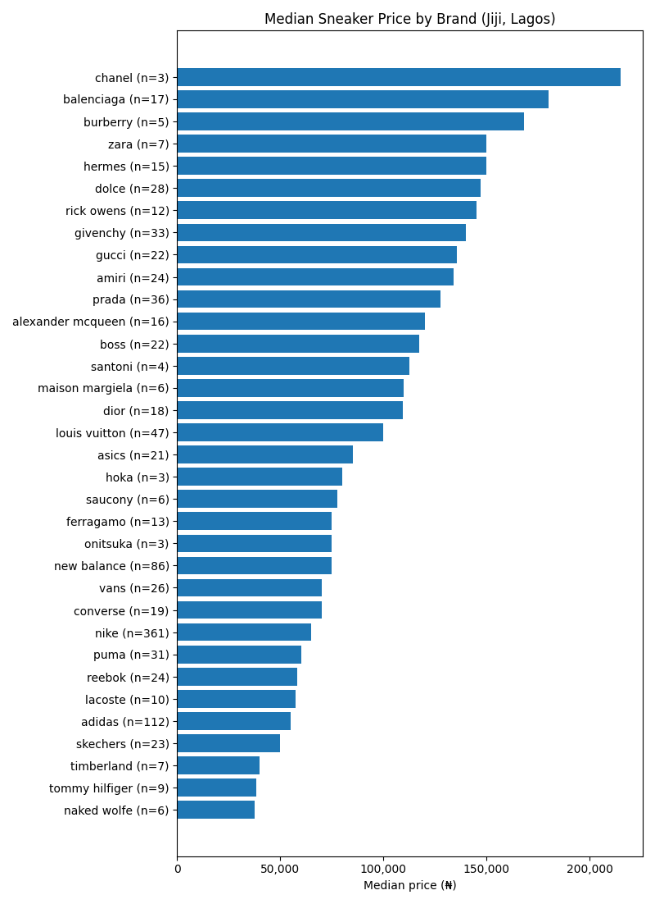
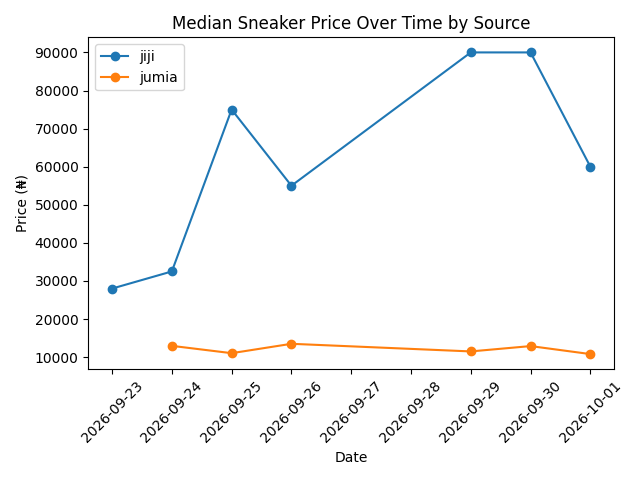

# Sneaker Price Prediction (Lagos)

Can a sneaker's price be predicted from its brand and the words in its title? This project scrapes Lagos sneaker listings from Jiji and Jumia, explores the data, and builds a linear regression model, adding features one round at a time and keeping only the ones that beat the noise.

## Results

Scored with 5-fold cross-validation on 1,041 listings across 23 brands. MAE is the average naira error of a prediction (lower is better).

| Model | MAE | Verdict |
|---|---|---|
| Naive baseline (always guess the median) | ₦38,605 | reference point |
| Round 1: brand only | ₦32,101 | beats the baseline |
| Round 2: + source (Jiji or Jumia) | ₦31,744 | dropped: only 25 Jumia rows |
| Round 3: + tier words (original, quality, luxury, premium) | ₦28,562 | **real gain** |
| Round 4: + model names (air force, chuck, ...) | ₦28,630 | dropped: no gain |
| **Round 5: + more title words (women, men, free, designer, new)** | **₦27,711** | **final model** |
| Round 6: + "available" | ₦27,807 | dropped: won only 2 of 5 folds |

**Final model: off by about ₦27,700 on average**, roughly a third of a typical listing price. About 28% better than guessing the median every time.





## What I learned

- **One train/test split can lie.** Round 1 scored ₦29,507 on a single split, but ₦32,101 once cross-validated. The single split happened to be the luckiest fold.
- **Compare models fold by fold.** The Round 5 gain over Round 3 (₦851) looked smaller than the fold-to-fold noise (about ₦1,600). Scoring both models on the same folds showed Round 5 won all 5, so the gain was real. Round 6 won only 2 of 5, so "available" was dropped.
- **Means mislead when outliers exist.** The mean error for listings containing "available" looked meaningful, but the median showed it came from a handful of very expensive listings.
- **A few listings dominate the error.** Removing the top 1% of prices (above ₦250,000) improved the MAE from ₦27,711 to ₦26,118.
- **Tier words beat model names.** "luxury" and "original" in a title carry real price signal after accounting for brand. Specific model names (Air Force, Chuck) added nothing, partly because each had only 14 to 67 listings.

## Limitations

- **No condition, size or seller data.** The listings don't show them, and they drive much of the price. This is the main reason the error stays high.
- **Thin brands.** Eight brands have fewer than 20 listings, so their price levels are unreliable (Rick Owens has 11).
- **Noisy labels.** Brands are assigned by matching words in titles. A few listings are mislabelled, and some titles list several brands.
- **Title words were chosen by looking at the whole dataset,** so the final score is slightly optimistic.
- **Linear regression predicts the mean,** which outlier listings pull upward. Typical listings come out slightly overpredicted.
- Jumia contributes only 25 listings to the model, so conclusions are really about Jiji.

## Why I stopped here

More tuning of this model has stopped paying off: Rounds 4 and 6 added nothing, and the remaining error comes from information the data doesn't contain. Next steps, in order of expected value:

1. Scrape condition and size.
2. Try a Random Forest, which can learn that a word means different things for different brands.
3. Try median regression, which suits the outlier problem.

## Project structure

| File | What it does |
|---|---|
| `scraper.py` | Collects listings from Jiji and Jumia and saves `sneakers.csv`. Labels each listing with a brand. |
| `analysis.py` | Charts (median price by brand, price trend) and replica/low-price flags. Saves to `charts/`. |
| `model.py` | Builds the feature rounds, cross-validates each one, and prints the results table and example estimates. |
| `sneakers_sample.csv` | 50 random rows showing the data format. |

## How to run

```bash
pip install pandas scikit-learn matplotlib requests beautifulsoup4

python scraper.py     # builds sneakers.csv (takes a few minutes)
python analysis.py    # charts + flagged listings
python model.py       # cross-validated results
```

`analysis.py` runs on the included sample if `sneakers.csv` is missing. `model.py` needs the full data and will tell you so.

## Data

The full dataset is not included. It was collected from public Jiji and Jumia listings, and only a 50-row sample is shared. Run the scraper to build your own. Please respect each site's terms of use, and keep the pauses between requests.

## License

MIT
